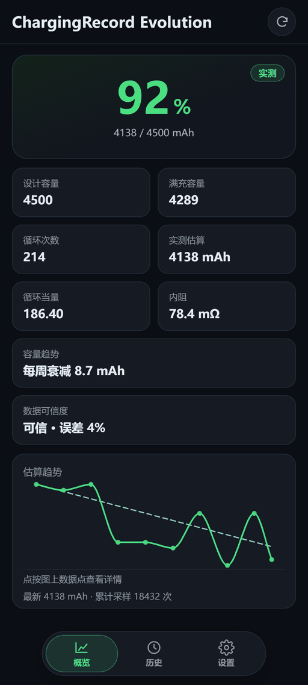
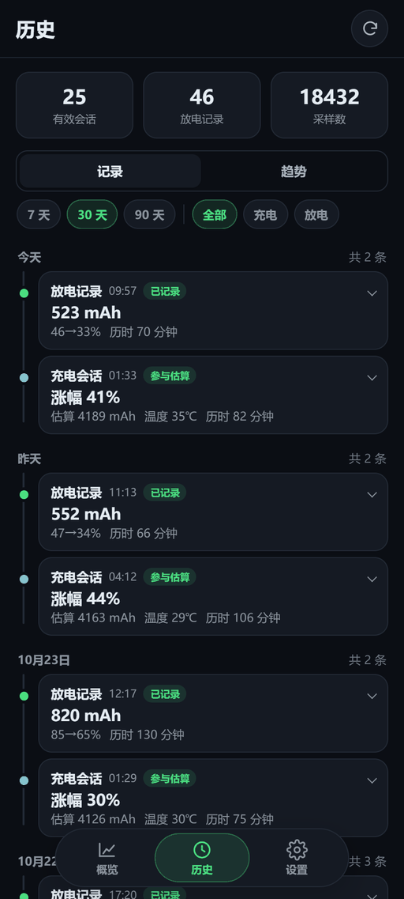
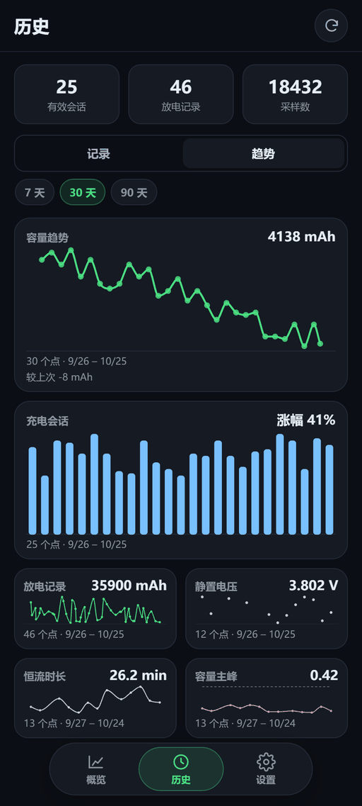
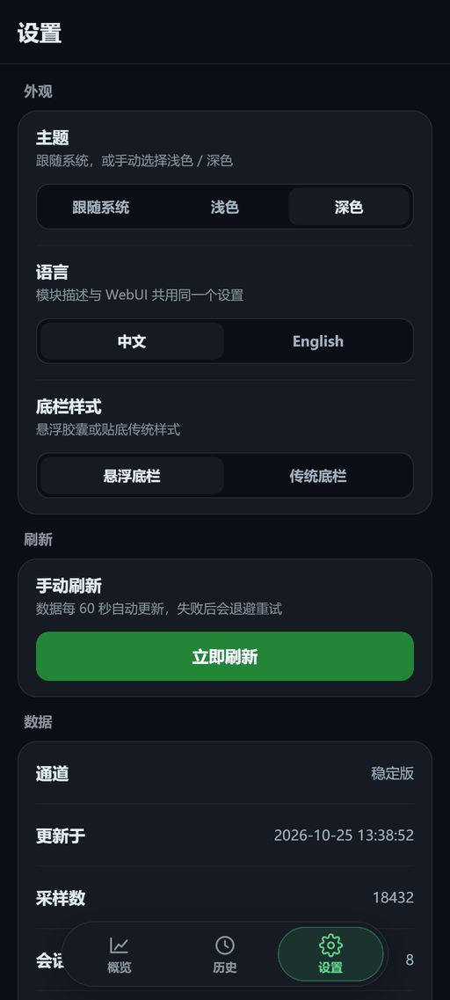
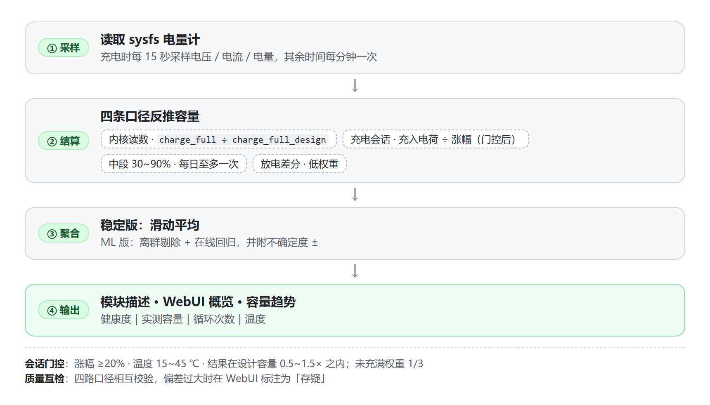

<div align="center">

# 🔋 ChargingRecord Evolution

**把电池健康度写在 root 管理器模块描述里，刷入即用，零配置**

[](https://github.com/f1owkang/CRecordEvolution/releases)
[](https://github.com/f1owkang/CRecordEvolution/releases)
[](https://go.dev)
[](#安装)
[](LICENSE)

[English](README_EN.md) | 简体中文

[特性](#特性) ｜ [界面预览](#界面预览) ｜ [安装](#安装) ｜ [工作原理](#工作原理) ｜ [常见问题](#常见问题) ｜ [从源码构建](#从源码构建) ｜ [致谢](#致谢)

</div>

---

## 界面预览

WebUI 三页（概览 / 历史 / 设置）一览。截图中的电池数据为**虚构的演示数据**，仅用于展示界面效果，不代表真实设备或实测结果。

<div align="center">

| 概览 | 历史 · 记录 | 历史 · 趋势 | 设置 |
| :---: | :---: | :---: | :---: |
| <a href=".github/images/overview-zh.png"></a> | <a href=".github/images/history-zh.png"></a> | <a href=".github/images/trends-zh.png"></a> | <a href=".github/images/settings-zh.png"></a> |

</div>

## 特性

- **健康度与容量实时可见**：模块描述直接显示内核健康度、满充容量、设计容量与实测估算，不用打开任何 App。
- **三页 WebUI**：概览 / 历史 / 设置；历史页按 7/30/90 天与充电/放电筛选，记录可分页、趋势图可点按放大。
- **多路容量互检**：内核满充、中段校准、放电差分与有效会话各算一路，差异明显时提示，避免单一口径带偏。
- **完全离线**：没有网络权限、没有遥测，数据只写入本机 `data/battery.db`，保留 90 天。
- **多管理器支持**：Magisk v20.4+ / KernelSU / APatch / MMRL，仅 arm64；升级自动保留旧学习记录。
- **双语界面**：简体中文 / English，安装时可选，之后可在 WebUI 随时切换。

## 安装

需要 Magisk v20.4+ / KernelSU / APatch 任一（仅 arm64），从 [Releases](https://github.com/f1owkang/CRecordEvolution/releases) 下载：

| 资产 | 通道 | 说明 |
| :-- | :--: | :-- |
| `CRecordEvolution-*.zip` | 稳定 | 统计算法，支持应用内更新 |
| `CRecordEvolution_ML-*.zip` | 实验 | 在线学习算法，只能手动刷入 |

### 刷入流程

管理器选 zip 后只需两步按键（App 内安装与 Magisk 恢复模式一致）：选语言（音量+ 中文 / 音量- English，12 秒后跟随系统）→ 确认安装（音量+ 安装 / 音量- 取消，30 秒后取消），然后重启。

### 注意事项

- 两个变体同 id，互斥安装；
- 升级保留 `data/battery.db` 学习记录（安装器自动复制），无需手动备份；
- Magisk 低版本没有 Action 按钮，等重启刷新；
- 从旧版（模块 id 为 `Charging_Record`）升级需先卸载旧模块；
- 语言在安装时选择，之后可在 WebUI 切换，模块描述会立即刷新；未选择时跟随系统；
- KernelSU / APatch / MMRL 可直接打开模块 WebUI：底栏可在悬浮胶囊与贴底样式间切换，图表数据点可点按查看数值。

## 工作原理

描述里的数字来自两条独立的路：一条读内核电量计，一条由充电过程实测反推。

<div align="center">

<picture>
  <source media="(prefers-color-scheme: dark)" srcset=".github/images/how-it-works-zh-dark.png">
  
</picture>

</div>

### 为什么这样做

- **不做无限积分**：库仑计一路积下去误差越滚越大；每次充电重新反推，等于每次对表。
- **没充满就拔掉的会话不可靠**：这类会话推出来的容量普遍偏高（实测可差一成），只在大涨幅会话才采信。
- **中段更可信，放电差分最稳**：顶部几个百分点常提前报满，中间段的百分比读数更可信；放电差分不经 `current_now`，在芯片内积分，是几路口径里最稳的。

### 容量趋势

三种状态：攒够 21 天数据前显示进度；测不出明显变化时显示「无显著变化」；真衰减了才显示每周掉多少。健康电池长期停在「无显著变化」是正常的，短期噪声通常大于真实衰减。

### 附加观测

只作观测、不影响健康度：静置电压、恒流充电时长、增量容量主峰；数据不够时显示采集中，不是故障。

### 电流单位与校准

`current_now` 的单位并不统一（部分内核报 mA，`charge_*` 报 µAh），量纲判错会让充入电量整体差 1000 倍。模块先按 `charge_full` 的量纲归一，再在每次充电会话结算时用「电量计差分 vs 原始电流积分」反推并持久化电流刻度，之后所有读数按该刻度换算，重启后继续有效；整个过程自动完成，设置页「数据」可查看当前刻度。缺少 `charge_counter` 的机型没有标尺，只能用量纲初判。

> [!WARNING]
> 已知不准的情况：
> - 边玩边充时负载电流可能被算进充入电量，读数偏高；熄屏充电最准（满电后长时间高负载会识别并停计）；
> - 缺 `cycle_count` / `charge_full_design` 的机型，相应字段会省略或改从设备树读设计容量，不影响其他功能。

## 常见问题

<details>
<summary>健康度超过 100% 是不是坏了？</summary>

不是。出厂标称容量普遍保守，实际满充高于设计值很常见。

</details>

<details>
<summary>和 AccuBattery 有什么区别？</summary>

思路类似，都是库仑积分；区别在于本模块用 root 直接读内核电量计，无常驻通知、无网络权限，也不依赖 Android 的电池统计接口。

</details>

<details>
<summary>多久能看到实测估算？</summary>

正常用几天就能出第一个数；ML 版要攒够 30 次有效会话才开始体现差异。

</details>

<details>
<summary>升级模块会不会丢学习记录？</summary>

不会。刷入脚本会把旧版本的 `data/`（含 `battery.db`）复制进新版本，估算记录和循环历史完整保留。

</details>

## 从源码构建

WebUI 源码在 `webui/`（Preact + Vite），构建产物输出到 `webroot/`（生成目录，不提交）；Go daemon 是纯 Go 实现（SQLite 用 `modernc.org/sqlite`，不需要 CGO）：

```sh
pnpm install --frozen-lockfile
pnpm run verify   # 构建 + 离线扫描 + 50KB gzip 上限

go test ./... -count=1
CGO_ENABLED=0 GOOS=linux GOARCH=arm64 go build -trimpath -ldflags "-s -w" -o bin/batteryd ./cmd/batteryd
```

`bin/batteryd` 是随模块分发的原生可执行文件：`once` 刷新一次描述并打印读数（Action 按钮执行的就是它），`json` 输出概览/设置页快照，`history` 输出历史页分页数据，`diag` 输出脱敏诊断摘要（设置页「复制诊断」执行它）。开机常驻由 `service.sh` 启动 `batteryd daemon`；完整发版流程见 [`AGENTS.md`](AGENTS.md)。

## 论文支撑

设计过程中参考过的论文（PDF 库见 [`docs/`](docs/)）：

- He & Shin, ACM e-Energy '23 —— 静置电压指纹
- Severson et al., Nature Energy 2019 及其后续 —— 容量衰减预测
- Lin et al., Energy 2022 —— 恒流充电时长（CCCT）
- Fly & Chen 2020、MDPI Energies 2024 综述 —— 增量容量分析（ICA）
- arXiv 2410.06422 —— 概率 ML 不确定性量化
- Zhang et al., ICCK 2025 —— 库仑计累积误差

采用程度不一：Lin 2022（CCCT）与 He & Shin（静置电压）是直接采用的方法原型，参数按本机数据重新定标；其余是方法动机与背景阅读。核心容量反推是通用工程做法，不依赖上述论文。

> ML 版显示的 ± 是 RLS 相对不确定度指标，不是严格的统计置信区间。

## 贡献者

ChargingRecord Evolution 生态由以下贡献者共同打造（排名不分先后）：

<div align="center">

<a href="https://github.com/f1owkang"></a>
<a href="https://github.com/hcnk3HrzQe"></a>

</div>

## 致谢

- 设计思路：不会梦游的鱼
- 安装脚本：酷安@阿巴酱

喜欢这个项目的话欢迎提 PR 或点个 Star ⭐

## 免责声明

- 健康度、容量与循环数据都是**估算值**，由内核读数与充电过程推算，不保证与出厂标称或专业检测设备一致。
- 刷入本模块会修改系统的模块目录，**风险自负**；请先确认自己了解 Magisk / KernelSU / APatch 的刷入与回退方式。
- 本模块不构成任何维修或安全建议；电池鼓包、异常发热等问题请以厂商检测为准。
- 所有数据只保存在本机 `data/battery.db`，模块不发起网络请求，也不上传或收集任何信息。

## License

本项目以 [GPL-2.0](LICENSE) 协议开源。

---

<div align="center">

**Made with ❤ by [f1owkang](https://github.com/f1owkang)**

</div>
