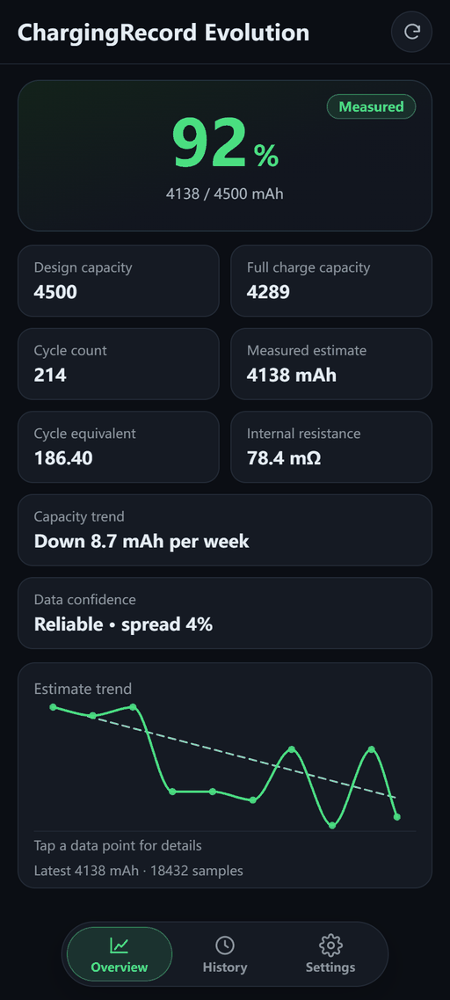
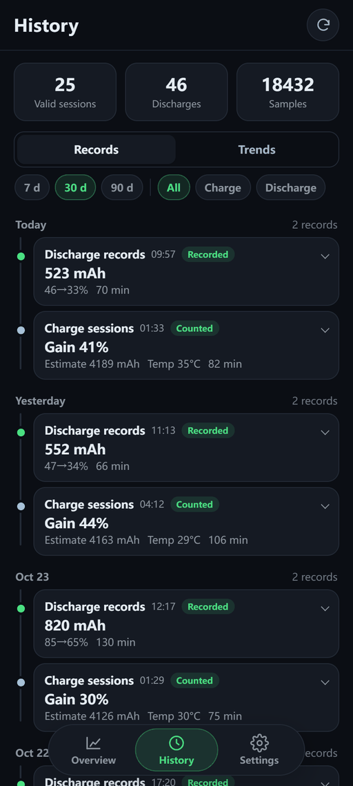
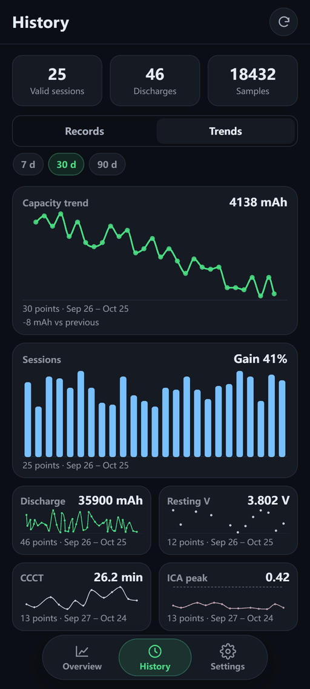
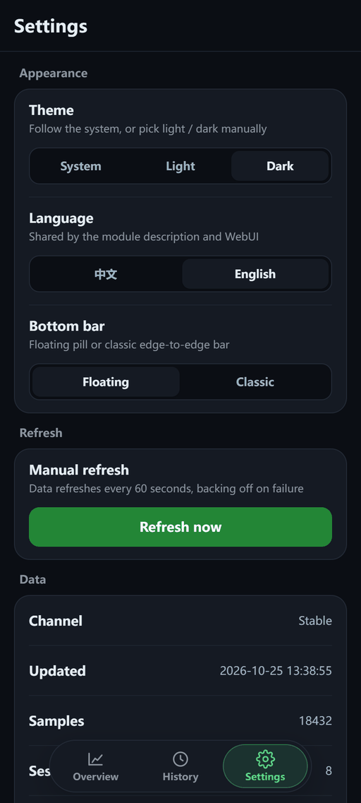
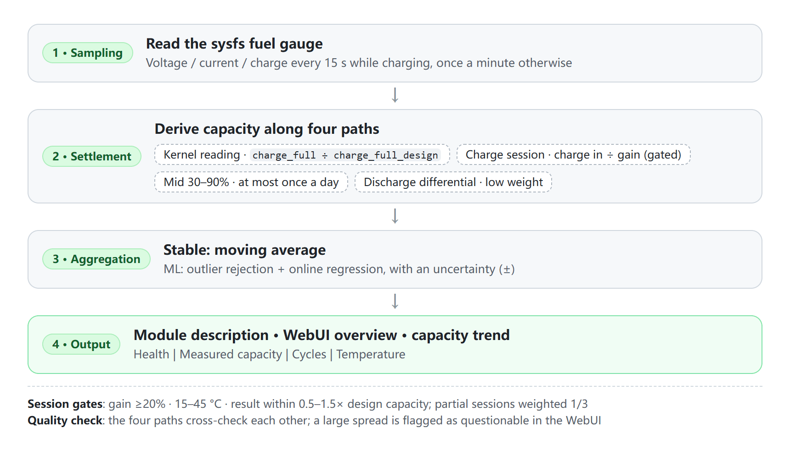

<div align="center">

# 🔋 ChargingRecord Evolution

**Battery health written right into your root manager's module description — flash and go, zero configuration**

[](https://github.com/f1owkang/CRecordEvolution/releases)
[](https://github.com/f1owkang/CRecordEvolution/releases)
[](https://go.dev)
[](#installation)
[](LICENSE)

English | [简体中文](README.md)

[Features](#features) | [Screenshots](#screenshots) | [Installation](#installation) | [How it works](#how-it-works) | [FAQ](#faq) | [Build from source](#build-from-source) | [Acknowledgements](#acknowledgements)

</div>

---

## Screenshots

The three WebUI pages (Overview / History / Settings) at a glance. The battery data in the screenshots is **fabricated demo data**, used only to illustrate the UI — it does not represent any real device or any measured result.

<div align="center">

| Overview | History · Records | History · Trends | Settings |
| :---: | :---: | :---: | :---: |
| <a href=".github/images/overview-en.png"></a> | <a href=".github/images/history-en.png"></a> | <a href=".github/images/trends-en.png"></a> | <a href=".github/images/settings-en.png"></a> |

</div>

## Features

- **Health and capacity at a glance**: the module description shows kernel health, full-charge and design capacities plus the measured estimate — no app needed.
- **Three-page WebUI**: Overview / History / Settings; history filters by 7/30/90 days and by charge/discharge, records page through, and trend charts expand on tap.
- **Cross-checked capacity paths**: kernel full charge, mid-stretch calibration, discharge differential and settled sessions each produce a value; a clear mismatch is flagged instead of trusting one path alone.
- **Fully offline**: no network permission, no telemetry; data is written only to the local `data/battery.db`, kept for 90 days.
- **Multiple managers supported**: Magisk v20.4+ / KernelSU / APatch / MMRL, arm64 only; upgrades keep the previous learning history automatically.
- **Bilingual UI**: Simplified Chinese / English, selectable at install time and switchable any time in the WebUI.

## Installation

Requires Magisk v20.4+, KernelSU, or APatch (arm64 only). Download from [Releases](https://github.com/f1owkang/CRecordEvolution/releases):

| Asset | Channel | Notes |
| :-- | :--: | :-- |
| `CRecordEvolution-*.zip` | Stable | Statistical algorithm, supports in-app updates |
| `CRecordEvolution_ML-*.zip` | Experimental | Online-learning algorithm, manual flash only |

### Flashing

Pick the zip in your manager and answer two short prompts (the same in-app and in Magisk recovery): language (Volume Up = Chinese, Volume Down = English, 12 s timeout = follow system), then confirm (Volume Up = install, Volume Down = cancel, 30 s timeout = cancel), then reboot.

### Notes

- Both variants share the same id and are mutually exclusive;
- Upgrades keep the `data/battery.db` learning history (the installer copies the old data automatically), so no manual backup is needed;
- Older Magisk versions have no Action button; wait for a reboot;
- Upgrading from the old version (module id `Charging_Record`)? Uninstall it first — the two directory layouts are not interchangeable;
- The language is chosen at install time and can be switched later in the WebUI; the module description refreshes immediately. With no explicit choice it follows the system language;
- KernelSU / APatch / MMRL can open the bundled WebUI: the bottom bar toggles between a floating pill and the classic edge-to-edge style, and chart points can be tapped for exact values.

## How it works

The numbers in the description come from two independent paths: one reads the kernel fuel gauge, the other back-calculates from the charging process.

<div align="center">

<picture>
  <source media="(prefers-color-scheme: dark)" srcset=".github/images/how-it-works-en-dark.png">
  
</picture>

</div>

### Why it works this way

- **No indefinite integration**: a coulomb counter would keep accumulating error; re-deriving the capacity on every charge is like re-syncing a clock.
- **Partial sessions are unreliable**: their derived capacity tends to run high (up to 10% in measured data), so only large-swing sessions are accepted.
- **The mid stretch is more trustworthy, and the discharge differential is the steadiest**: the top few percentage points often report full early, while percentages in the middle hold up better; the discharge differential never goes through `current_now` and integrates inside the chip.

### Capacity trend

Three states: progress until 21 days of data; "no significant change" when no clear movement can be measured; and a weekly loss only once real degradation sets in. A healthy battery staying at "no significant change" is normal — short-term noise is usually larger than real degradation.

### Extra observations

Observations only, never affecting health: resting voltage, constant-current charge time and the incremental-capacity main peak; they show as collecting when data is insufficient — not a fault.

### Current units and calibration

`current_now` is not consistent in practice: some kernels report mA while `charge_*` stays in µAh, and a wrong dimension scales the charge input by 1000×. The module first normalises by the dimension of `charge_full`, then at every charge-session settlement back-derives the current scale from "fuel-gauge differential vs the integral of raw current readings" and persists it; all later readings are converted with that scale, surviving reboots. Everything is automatic — the Settings → "Data" section shows the active scale. Devices without a `charge_counter` node have no reference and keep the dimension-based initial guess.

> [!WARNING]
> Known inaccuracies:
> - Using the phone while charging can count load current as charge input, so readings run high; screen-off charging is the most accurate (prolonged high-load use after reaching full is detected and stopped);
> - Devices without `cycle_count` / `charge_full_design` have the corresponding fields omitted or read the design capacity from the device tree; nothing else is affected.

## FAQ

<details>
<summary>Is a health reading above 100% a sign of something broken?</summary>

No. Factory-rated capacity is generally conservative, so the actual full-charge capacity often exceeds the design value.

</details>

<details>
<summary>How is this different from AccuBattery?</summary>

The idea is similar — both integrate charge. The difference is that this module uses root to read the kernel fuel gauge directly: no persistent notification, no network permission, and no dependency on Android's battery stats API.

</details>

<details>
<summary>How long until I see a measured estimate?</summary>

A few days of normal use gets you the first number; the ML build needs 30 valid sessions before it starts to diverge.

</details>

<details>
<summary>Will upgrading the module lose my learning history?</summary>

No. The flash script copies the old version's `data/` directory (including `battery.db`) into the new version, so estimate records and cycle history are preserved intact.

</details>

## Build from source

The WebUI source lives in `webui/` (Preact + Vite) and builds into `webroot/` (generated, not committed); the Go daemon is pure Go (SQLite via `modernc.org/sqlite`, no CGO needed):

```sh
pnpm install --frozen-lockfile
pnpm run verify   # build + offline scan + 50KB gzip ceiling

go test ./... -count=1
CGO_ENABLED=0 GOOS=linux GOARCH=arm64 go build -trimpath -ldflags "-s -w" -o bin/batteryd ./cmd/batteryd
```

`bin/batteryd` is the native executable shipped in the module: `once` refreshes the description and prints the current readings (what the manager's Action button runs), `json` emits the Overview/Settings snapshot, `history` emits the paged History data, and `diag` emits a redacted diagnostics summary (Settings → "Copy diagnostics"). On boot `service.sh` starts `batteryd daemon`; see [`AGENTS.md`](AGENTS.md) for the full release flow.

## Research

Papers consulted during design (PDF library in [`docs/`](docs/)):

- He & Shin, ACM e-Energy '23 — resting-voltage fingerprinting
- Severson et al., Nature Energy 2019 and follow-ups — capacity fade prediction
- Lin et al., Energy 2022 — constant-current charge time (CCCT)
- Fly & Chen 2020, MDPI Energies 2024 review — incremental capacity analysis (ICA)
- arXiv 2410.06422 — probabilistic ML uncertainty quantification
- Zhang et al., ICCK 2025 — coulomb-counter accumulation error

Adoption varies: Lin 2022 (CCCT) and He & Shin (resting voltage) are the method prototypes adopted directly, with parameters recalibrated against this device's data; the rest served as motivation and background reading. The core capacity back-calculation is a standard engineering practice and does not depend on the papers above.

> The ± shown by the ML build is an RLS relative-uncertainty indicator, not a strict statistical confidence interval.

## Contributors

ChargingRecord Evolution is built by the following contributors (in no particular order):

<div align="center">

<a href="https://github.com/f1owkang"></a>
<a href="https://github.com/hcnk3HrzQe"></a>

</div>

## Acknowledgements

- Design concept: 不会梦游的鱼
- Install script: 酷安@阿巴酱

If you like the project, PRs and stars are welcome ⭐

## Disclaimer

- Health, capacity and cycle figures are **estimates** derived from kernel readings and the charging process; they are not guaranteed to match factory ratings or professional test equipment.
- Flashing this module modifies your system's module directory — **proceed at your own risk**, and only after you understand how to flash and roll back with Magisk / KernelSU / APatch.
- Nothing here constitutes repair or safety advice; for swelling, abnormal heat or other battery faults, rely on the manufacturer's diagnostics.
- All data stays in the local `data/battery.db`; the module makes no network requests and never uploads or collects anything.

## License

This project is licensed under [GPL-2.0](LICENSE).

---

<div align="center">

**Made with ❤ by [f1owkang](https://github.com/f1owkang)**

</div>
